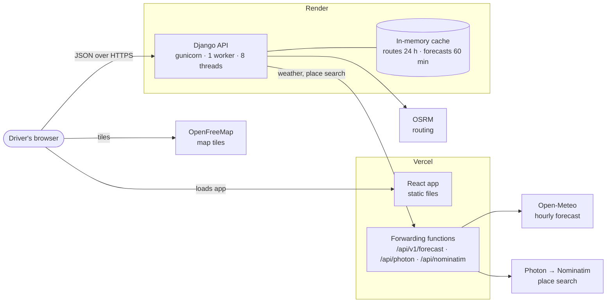
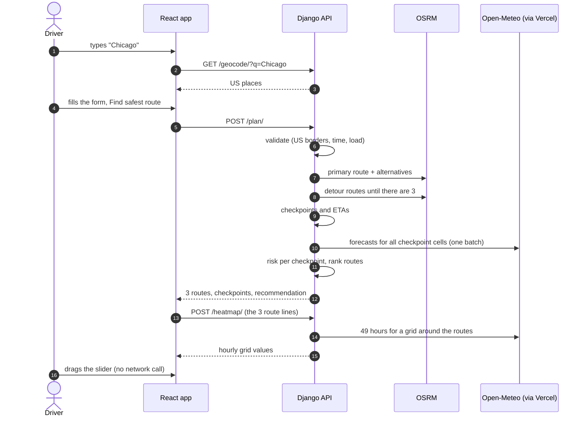

# Weather-Aware Truck Routing

[](https://github.com/Faizan404/weather-aware-truck-routing/actions/workflows/ci.yml)

Pick the safest truck route between two US places, based on **the weather the truck will actually drive into**, its **load weight** and **travel time**.

| | |
|---|---|
| **Live app** | **https://weather-aware-truck-routing-mocha.vercel.app/** |
| API health | https://truck-routing-api-mo4g.onrender.com/api/v1/health/ |
| Stack | React 19 + TypeScript + MapLibre (Vercel) · Django 5 + DRF (Render, Docker) |
| Cost | Free services only, no API keys |

> The API runs on Render's free plan and sleeps when idle. The first request after a quiet spell can take up to a minute; the app says so while it waits.

---

## Contents

1. [What the app does](#1-what-the-app-does)
2. [Try it in one minute](#2-try-it-in-one-minute)
3. [Architecture](#3-architecture)
4. [Tech stack](#4-tech-stack)
5. [How a plan is made, step by step](#5-how-a-plan-is-made-step-by-step)
6. [The risk rules](#6-the-risk-rules)
7. [How the route is recommended](#7-how-the-route-is-recommended)
8. [The forecast map and 0–48 h slider](#8-the-forecast-map-and-048-h-slider)
9. [What you see on screen](#9-what-you-see-on-screen)
10. [Project structure](#10-project-structure)
11. [API reference](#11-api-reference)
12. [External services and their limits](#12-external-services-and-their-limits)
13. [Run it locally](#13-run-it-locally)
14. [Tests and CI](#14-tests-and-ci)
15. [Deployment](#15-deployment)
16. [Interpretation decisions](#16-interpretation-decisions)
17. [Edge cases handled](#17-edge-cases-handled)
18. [Known limitations](#18-known-limitations)

---

## 1. What the app does

A normal map app picks the fastest road. A heavy truck also cares whether it will hit 50 mph wind or heavy snow on the way, and weather moves while the truck drives. This app:

1. gets **3 different routes** for the trip;
2. places **weather checkpoints every 10, 25 or 50 miles** along each route;
3. works out **when the truck reaches each checkpoint**, and reads the forecast **for that place at that hour**;
4. rates each checkpoint **Low → Moderate → High → Severe → No Travel** using the brief's wind, rain and snow thresholds, plus stricter wind rules for heavy loads;
5. **recommends one route** (fewest No Travel / Severe / High miles, then lowest average risk, then shortest drive) and **says why it won**;
6. draws everything on a map, with a **weather heatmap around the routes** and a **0–48 hour slider**.

## 2. Try it in one minute

Open the [live app](https://weather-aware-truck-routing-mocha.vercel.app/) and enter:

| Field | Value |
|---|---|
| From | `Chicago` → pick *Chicago, Illinois, United States* |
| To | `Denver` → pick *Denver, Colorado, United States* |
| Departure | tomorrow, 8:00 AM |
| Load weight | `35000` |
| Check the weather every | `25 mi` |

Press **Find safest route**. You'll get three routes (about 1,000–1,150 mi), a recommendation such as *"Shortest travel time: 17h 49m vs 19h 54m on the next best route"*, every checkpoint's ETA and weather, and the forecast map. Then try:

- **Click another route card** (or use ↑/↓) to see its checkpoints on the map and in the list.
- **Switch to 10 mi**: more checkpoints, same trip.
- **Set the load to 80000** on a windy day: 35–44 mph wind turns *Severe* instead of *High*.
- **Drag the slider** to see how the weather moves over the next 48 hours.

## 3. Architecture



- **The browser** loads the React app from Vercel, then talks **directly** to the Django API on Render (CORS-restricted to the app's origin) and to OpenFreeMap for map tiles.
- **The API** does all the work: routing, checkpoints, weather, risk and ranking. It's the only part that calls third-party services, so it can cache, batch and rate-limit them.
- **Weather and place search go through small Vercel functions.** Open-Meteo, Photon and Nominatim limit free use per IP, and Render's shared outgoing IP was already throttled, so the API reaches them from Vercel's network instead. See [Deployment](#15-deployment).
- **No database.** Nothing is stored; caches only avoid repeating calls.

## 4. Tech stack

### Frontend (`frontend/`, hosted on Vercel)

| Tool | Version | Used for |
|---|---|---|
| [React](https://react.dev) + [TypeScript](https://www.typescriptlang.org) | 19 / 7 | The UI |
| [Vite](https://vite.dev) | 8 | Dev server (proxies `/api` to Django), production build, build-time config checks |
| [TanStack Query](https://tanstack.com/query) | 5 | Server data: caching, request cancellation, loading and error states |
| [MapLibre GL JS](https://maplibre.org) | 6 | The interactive map (WebGL), loaded lazily |
| [OpenFreeMap](https://openfreemap.org) | | Free vector basemap (light and dark styles) |
| [Tailwind CSS](https://tailwindcss.com) | 4 | Styling, with design tokens for light/dark themes |
| [Lucide](https://lucide.dev) | | Icons |
| [@mapbox/polyline](https://github.com/mapbox/polyline) | | Decoding the route lines the API sends |
| [Overpass](https://github.com/RedHatOfficial/Overpass) font | | Self-hosted typeface (SIL Open Font License) |
| [Vitest](https://vitest.dev) | 5 | Unit and component tests |
| [Oxlint](https://oxc.rs) | 1 | Linting |
| Vercel Functions | | `api/v1/forecast.js`, `api/photon/api.js`, `api/nominatim/search.js`: forward weather and place-search requests (shared helper `api/_forward.js`) |

### Backend (`backend/`, hosted on Render)

| Tool | Version | Used for |
|---|---|---|
| [Python](https://www.python.org) | 3.12 | Language (Docker image) |
| [Django](https://www.djangoproject.com) | 5.2 | Web framework, settings, middleware, cache |
| [Django REST Framework](https://www.django-rest-framework.org) | 3.18 | JSON endpoints, request validation, per-IP throttling |
| [httpx](https://www.python-httpx.org) | 0.28 | Calls to OSRM, Photon, Nominatim and Open-Meteo |
| [django-cors-headers](https://github.com/adamchainz/django-cors-headers) | 4.9 | Lets only the frontend's origin call the API from a browser |
| [django-redis](https://github.com/jazzband/django-redis) | 7 | Optional shared cache when `REDIS_URL` is set (in-memory otherwise) |
| [Gunicorn](https://gunicorn.org) | 27 | Production server (1 worker, 8 threads) |
| [WhiteNoise](https://whitenoise.readthedocs.io) | 6.12 | Serving static files |
| [python-dotenv](https://github.com/theskumar/python-dotenv) | 1.2 | Loading `.env` in development |
| [pytest](https://pytest.org) + [pytest-django](https://pytest-django.readthedocs.io) + [respx](https://lundberg.github.io/respx/) | 9 / 4.14 / 0.23 | Tests, with every outgoing HTTP call mocked |
| [Ruff](https://docs.astral.sh/ruff/) | 0.14 | Linting and import order |
| [mypy](https://mypy-lang.org) + django-stubs + DRF stubs | 1.18 | Type checking |

### External services (free, no API keys)

| Service | Used for |
|---|---|
| [OSRM](https://project-osrm.org) public server | Routes and per-segment drive times |
| [Open-Meteo](https://open-meteo.com) | Hourly wind, rain and snow forecasts |
| [Photon](https://photon.komoot.io), [Nominatim](https://nominatim.openstreetmap.org) | Place search (Nominatim as fallback) |
| [US Census TIGER/Line](https://www.census.gov/geographies/mapping-files/time-series/geo/tiger-line-file.html) | State boundaries for the local "is it in the US?" check (bundled, public domain) |

### Infrastructure and tooling

| Tool | Used for |
|---|---|
| [Render](https://render.com) (free plan, Docker) | Hosting the API (`render.yaml`, `backend/Dockerfile`) |
| [Vercel](https://vercel.com) | Hosting the frontend and the forwarding functions (`frontend/vercel.json`, `frontend/api/`) |
| [Docker](https://www.docker.com) / Docker Compose | The API image (non-root); local stack with Redis (`docker-compose.yml`) |
| [GitHub Actions](https://github.com/features/actions) | CI: lint, types, tests, deploy checks, Docker build (`.github/workflows/ci.yml`) |
| `scripts/smoke.sh` (curl + Python) | Post-deploy check of the live API and app |

## 5. How a plan is made, step by step



### Step 1 · Find the places
The From/To boxes ask `GET /api/v1/geocode/?q=…` after 300 ms of typing (3+ characters). The API asks **Photon** (which handles partial words like "Chica"), biased towards the middle of the US, and keeps US towns and cities ahead of streets and buildings; if Photon fails it falls back to **Nominatim**. Photon results are cached 24 h, Nominatim fallback results 10 minutes, empty results never. You must pick a suggestion (or type `lat, lon`) so the trip has exact coordinates.
*Files:* `frontend/src/components/PlaceInput.tsx` → `backend/planner/views.py` (`geocode`) → `backend/routing/geocoding.py` → `frontend/api/photon/api.js`, `frontend/api/nominatim/search.js` (forwarders)

### Step 2 · Validate the request
`POST /api/v1/plan/` carries origin, destination, departure (ISO 8601 with a timezone), load (0–80,000 lb) and interval (10/25/50). The API checks:
- both points are inside the **50 states or DC**, with a local point-in-polygon test against bundled US Census boundaries (no network call);
- the departure is not in the past and at most **14 days** ahead (the forecast covers 16);
- origin and destination differ.

Per-IP throttles (20 plans/min) protect the shared free quotas.
*Files:* `frontend/src/components/TripForm.tsx` (same checks client-side) → `backend/planner/serializers.py` → `backend/core/borders.py` + `core/data/us_states.geojson`, `backend/core/throttling.py`, `backend/core/client_ip.py`

### Step 3 · Get three routes
OSRM's public server usually returns only 1–2 routes, so the API makes more: it forces a waypoint off to each side of the primary route's midpoint (15%, then 30% of the route length) and routes through it. A candidate is dropped if it overlaps an existing route by ≥ 85%, is more than 1.6× as long or 1.5× as slow as the primary, or **drives out and back on itself**. Calls are spaced 1 s apart (OSRM's policy) and stop as soon as there are 3 routes. Routes are cached for 24 h, stored thinned and compact.
*Files:* `backend/routing/service.py`, `backend/routing/providers/osrm.py`, `backend/routing/models.py`, `backend/core/http.py` (spacing, retries, timeouts)

### Step 4 · Place checkpoints and work out ETAs
Checkpoints sit at mile 0, 25, 50, … and at the destination. OSRM gives the drive time of every segment, so each point on the route knows its **cumulative drive time**. A checkpoint's **ETA = departure + drive time to that mile**. Each checkpoint "covers" half the distance to its neighbours, so a route's miles always add up to its length.
*Files:* `backend/planner/services.py` (`plan_trip`), `backend/core/geo.py` (sampling, interpolation)

### Step 5 · Get the weather at each ETA
Checkpoints are snapped to grid cells (0.1° for 10 mi, 0.25° for 25/50 mi; coarser on very long trips), **deduplicated across all three routes** and fetched from Open-Meteo in batched requests. Each checkpoint takes the **forecast hour nearest its ETA**: wind speed (mph), rain + showers (in/hr), snowfall (in/hr). A rolling budget (480 locations/min) keeps the app under Open-Meteo's limits. Missing data becomes **Unknown**, never Low.
*Files:* `backend/weather/open_meteo.py`, `backend/core/quota.py`, `frontend/api/v1/forecast.js` (the forwarding function)

### Step 6 · Rate each checkpoint
Wind, rain and snow each get a level from the [threshold table](#6-the-risk-rules); the load rules can raise the wind level; the checkpoint takes the **worst** of the three and records why (e.g. *"Wind 47 mph + 35,000 lb load"*).
*File:* `backend/risk/rules.py`

### Step 7 · Rank the routes and explain
Each route gets miles per level, average risk and its drive time. Routes are sorted by the [ranking rules](#7-how-the-route-is-recommended) and the response names the deciding criterion, e.g. *"Fewest Severe miles: 0 mi vs 48 mi on the next best route."*
*File:* `backend/risk/scoring.py`

### Step 8 · Show the result
The response holds 3 routes (simplified geometry, risk-coloured segments, checkpoints) and the recommendation. The React app selects the recommended route and draws the cards, the checkpoint list and the map.
*Files:* `frontend/src/hooks/useTripPlan.ts` (all trip state) → `usePlan.ts` → `components/PlanResults.tsx`, `RouteCards.tsx`, `CheckpointList.tsx`, `MapPanel.tsx` → `MapView.tsx`

### Step 9 · Load the forecast map
Right after, the app sends the three route lines to `POST /api/v1/heatmap/`. The API builds a grid of cells around the routes (about 50 km either side, at most 220 cells), fetches **49 hourly values** per cell (departure + 0…48 h) and returns risk, wind, rain and snow for each. Dragging the slider then only changes which hour the map colours, with **no network call**.
*Files:* `frontend/src/hooks/useHeatmap.ts`, `components/ForecastSlider.tsx`, `lib/geojson.ts`, `lib/mapLayers.ts` → `backend/planner/services.py` (`heatmap`, `corridor_points`)

## 6. The risk rules

From the brief (`backend/risk/rules.py`, served by `GET /api/v1/risk-rules/` so the legend never disagrees with the backend):

| Condition | Low | Moderate | High | Severe | No Travel |
|---|---|---|---|---|---|
| Wind (mph) | < 25 | 25–34 | 35–44 | 45–54 | ≥ 55 |
| Rain (in/hr) | < 0.10 | 0.10–0.25 | 0.25–0.50 | 0.50–1.00 | > 1.00 |
| Snow (in/hr) | < 0.5 | 0.5–1.0 | 1.0–2.0 | 2.0–3.0 | > 3.0 |

**Load rules** (applied to wind; weight compared with a strict `>`):

| Wind | Load | Result |
|---|---|---|
| ≥ 55 mph | any load | No Travel |
| 45–54 mph | over 30,000 lb | No Travel |
| 35–44 mph | over 40,000 lb | Severe |

A checkpoint's level is the **worst** of wind (after the load rules), rain and snow.

## 7. How the route is recommended

Routes are compared on these criteria, in order; the first one that differs decides (`backend/risk/scoring.py`):

1. **Forecast coverage**: a route with more than 10% of its miles Unknown ranks after routes with complete forecasts (and the notes say so).
2. **Fewest No Travel miles**
3. **Fewest Severe miles**
4. **Fewest High miles**
5. **Lowest average risk**: distance-weighted (Low 0 … No Travel 4). Differences **under 0.1 count as a tie**: a long detour has more calm miles that dilute the same risky stretch, and without the tie Atlanta → Miami picked a route 214 mi / 6 h longer for 0.03 vs 0.04.
6. **Shortest travel time**

Miles are rounded so float noise can't decide. If a faster route lost, the reason explains that instead, e.g. *"Route A is 2h 00m faster but has 25 mi of High risk."* If every route has No Travel miles, the app shows *"No safe route at this departure time"*.

## 8. The forecast map and 0–48 h slider

- **Route colours** show each place **at the moment the truck arrives** there.
- **The heatmap** shows the **whole area at one moment**: the hour picked on the slider (hour 0 = departure).

So the heatmap can show a storm on a route that stays green: it arrives after the truck has passed. Set the slider to a checkpoint's ETA and the two agree. Layers: **Risk** (for your load), **Wind**, **Rain**, **Snow**; their colour scales come from `/risk-rules/`. Cells are soft circles coloured by their own value, so calm areas never add up into "danger".

## 9. What you see on screen

| Part | What it does | Component |
|---|---|---|
| Header | App name; light / dark / system theme | `AppHeader.tsx`, `ThemeSwitch.tsx` |
| Trip form | From, To, departure, load, interval, submit. Changing only the interval re-plans at once; after other edits it waits for the button | `TripForm.tsx`, `PlaceInput.tsx`, `Field.tsx` |
| Recommendation card | The route to take, why, and notes (e.g. missing data) | `PlanResults.tsx` |
| Warnings | E.g. *"Weather service limit reached, try again later"* | `Notice.tsx` |
| Route cards | Distance, drive time, Severe+ and High miles, risk bar, average risk, arrival. Click or ↑/↓/Home/End to select | `RouteCards.tsx`, `RiskChip.tsx` |
| Checkpoint list | Mile, ETA, wind/rain/snow, reason and level for the selected route; hover links to the map | `CheckpointList.tsx` |
| Map | Risk-coloured routes, checkpoint dots with popups, start dot and finish flag | `MapView.tsx`, `lib/mapLayers.ts`, `lib/mapPopup.ts` |
| Legend | The six colours; "Risk rules" opens the full table | `Legend.tsx` |
| Forecast panel | Heatmap on/off, layer, play, 0–48 h slider, colour scale (collapsed on phones) | `ForecastSlider.tsx` |

Phones and tablets get a stacked layout (map on top; the page scrolls to the recommendation after a plan loads). The map library loads after the form, so the form is usable straight away.

## 10. Project structure

```
weather-aware-truck-routing/
├── backend/                         Django API (Render, Docker)
│   ├── config/
│   │   ├── settings.py              All settings from environment variables; security headers when DEBUG is off
│   │   ├── settings_test.py         Test defaults, so tests need no .env
│   │   └── urls.py                  /api/v1/ routes; JSON 404s
│   ├── planner/                     The HTTP layer
│   │   ├── views.py                 Endpoints: health, risk-rules, geocode, plan, heatmap
│   │   ├── serializers.py           Request validation (US check, time window, load range)
│   │   ├── services.py              plan_trip(): routes → checkpoints → weather → risk → ranking; heatmap()
│   │   └── urls.py
│   ├── routing/
│   │   ├── service.py               3 distinct routes: alternatives, detours, filters, cache
│   │   ├── providers/osrm.py        OSRM client and response parsing
│   │   ├── models.py                Route: coordinates with cumulative miles and drive time
│   │   └── geocoding.py             Place search: Photon (US bias, places first), then Nominatim; caching
│   ├── weather/
│   │   └── open_meteo.py            Batched, cached forecasts; grid cells; quota budget
│   ├── risk/
│   │   ├── rules.py                 Thresholds and load rules (the single source of truth)
│   │   └── scoring.py               Miles per level, average risk, ranking, reason text
│   ├── core/                        Shared building blocks
│   │   ├── geo.py                   Distances, polylines, sampling, interpolation
│   │   ├── borders.py               Point-in-US check; data/us_states.geojson (Census boundaries)
│   │   ├── http.py                  Outgoing HTTP: User-Agent, 1 req/s spacing, retries, 429 cool-down
│   │   ├── quota.py                 Rolling per-minute/hour/day budget for Open-Meteo
│   │   ├── deadline.py              60 s time budget per plan/heatmap request
│   │   ├── throttling.py            Per-IP request limits
│   │   ├── client_ip.py             Client IP behind Cloudflare/proxies
│   │   ├── middleware.py            Early health check; X-Request-ID in responses and logs
│   │   ├── health.py, exceptions.py Health payload; consistent {"error": …} responses
│   ├── scripts/build_us_borders.py  Rebuilds us_states.geojson from the Census file
│   ├── tests/                       246 pytest tests (HTTP mocked, no network)
│   ├── Dockerfile                   Non-root image, gunicorn
│   ├── requirements.txt / -dev.txt
│   └── pyproject.toml               ruff and mypy settings
│
├── frontend/                        React app (Vercel)
│   ├── api/                         Vercel functions forwarding to free services from Vercel's network:
│   │   ├── _forward.js              shared GET-only forwarder (not deployed as a function itself)
│   │   ├── v1/forecast.js           → Open-Meteo
│   │   ├── photon/api.js            → Photon
│   │   └── nominatim/search.js      → Nominatim
│   ├── src/
│   │   ├── main.tsx, App.tsx        Entry point; page layout
│   │   ├── api/                     client.ts (fetch, timeouts, error messages), types.ts, queryKeys.ts
│   │   ├── hooks/                   useTripPlan (all trip state), usePlan, useHeatmap, useRiskRules,
│   │   │                            useTheme, useSlowPending (cold-start notice), useTripScopedState, …
│   │   ├── components/              UI pieces (see "What you see on screen")
│   │   ├── lib/                     Pure logic: risk colours, legend and scales from /risk-rules/,
│   │   │                            GeoJSON builders, map layers, formatting, trip and keyboard helpers
│   │   ├── index.css                Design tokens (light/dark), claymorphism surfaces
│   │   └── *.test.ts(x)             78 Vitest tests next to the code they test
│   ├── public/theme-init.js         Applies the saved theme before first paint
│   ├── vercel.json                  Build settings and security headers (CSP, nosniff, …)
│   └── vite.config.ts               Dev proxy to the API; fails a production build without VITE_API_URL
│
├── scripts/smoke.sh                 Post-deploy check of a live API + app
├── .github/workflows/ci.yml         Lint, types, tests, deploy checks, Docker build
├── render.yaml                      Render blueprint for the API
└── docker-compose.yml               Local stack: API, app, Redis
```

## 11. API reference

Base path `/api/v1`. Errors always look like `{"error": {"code", "message", "details"}}`. Responses carry an `X-Request-ID`.

| Method | Path | Input | Returns | Limit |
|---|---|---|---|---|
| GET, HEAD | `/health/` | | `{status, version, weather_budget_minute_left}` | |
| GET | `/risk-rules/` | | Thresholds, levels and load rules | |
| GET | `/geocode/?q=` | `q` ≥ 3 characters | `{results: [{label, lat, lon}]}` (US only) | 60/min per IP |
| POST | `/plan/` | `{origin: {lat, lon, label?}, destination: {…}, departure_time: ISO 8601 with offset, load_weight_lbs: 0–80000, interval_miles: 10\|25\|50}` | `routes[]` (geometry, segments, checkpoints, summary), `recommendation`, `warnings` | 20/min per IP |
| POST | `/heatmap/` | `{polylines: [≤ 3 encoded polylines], departure_time, load_weight_lbs}` | `hours[49]`, `points[]`, and per point 49 hourly values of `risk`, `wind_mph`, `rain_in_hr`, `snow_in_hr` | 20/min per IP |

Common error codes: `validation_error` (400), `no_route` (422), `throttled` (429, with `Retry-After`), `upstream_unavailable` / `upstream_timeout` (503).

## 12. External services and their limits

| Service | Used for | Limit | How the app respects it |
|---|---|---|---|
| [OSRM](https://router.project-osrm.org) public server | Routes | 1 request/s, identify yourself | Process-wide 1 s spacing, never parallel; User-Agent with the repo URL; routes cached 24 h |
| [Open-Meteo](https://open-meteo.com) | Hourly forecasts | 600/min, 5,000/h, 10,000/day **per IP**; non-commercial | Budget of 480/min, 4,000/h, 8,000/day; cells shared between routes; long trips use coarser cells; 60-min cache; reached through the Vercel function |
| [Photon](https://photon.komoot.io) → [Nominatim](https://nominatim.openstreetmap.org) | Place search | Fair use **per IP**; Nominatim 1 request/s | Debounced input; spacing per real service (0.3 s Photon, 1 s Nominatim) even through the forwarders; cache 24 h (Photon) / 10 min (Nominatim); reached through Vercel functions |
| [OpenFreeMap](https://openfreemap.org) | Map tiles | Fair use | Loaded by the browser |

A `429` is never retried: calls to that host pause for 60 s (or its `Retry-After`). Only network errors and 5xx are retried, with backoff. These are free community services; real traffic should use self-hosted OSRM/geocoding and a paid Open-Meteo plan (only the `*_URL` settings change).

## 13. Run it locally

Requirements: Python 3.12+, Node 22+.

```bash
git clone https://github.com/Faizan404/weather-aware-truck-routing.git
cd weather-aware-truck-routing

# API on http://127.0.0.1:8765
cd backend
python3 -m venv .venv && .venv/bin/pip install -r requirements-dev.txt
cp .env.example .env
.venv/bin/python manage.py runserver 8765

# App on http://localhost:5173 (second terminal; Vite proxies /api to the API)
cd frontend
npm install
npm run dev
```

Or run everything (API, app, Redis) with `docker compose up`. Locally the API calls Open-Meteo, Photon and Nominatim directly; leave `OPEN_METEO_URL`, `PHOTON_URL` and `NOMINATIM_URL` unset.

## 14. Tests and CI

```bash
# Backend: lint, types, 246 tests (no network: HTTP is mocked)
cd backend && .venv/bin/ruff check . && .venv/bin/mypy && .venv/bin/pytest

# Frontend: lint, types, tests, production build
cd frontend && npm run lint && npm run typecheck && npm test
cd frontend && VITE_API_URL=https://truck-routing-api-mo4g.onrender.com/api/v1 npm run build
```

[CI](.github/workflows/ci.yml) runs all of these on every push and pull request, plus `manage.py check --deploy` with production settings and a Docker build that checks the image runs as a non-root user.

## 15. Deployment

| Part | Host | URL |
|---|---|---|
| React app | Vercel (root directory `frontend`) | https://weather-aware-truck-routing-mocha.vercel.app/ |
| Django API | Render, free plan, Docker (`render.yaml`) | https://truck-routing-api-mo4g.onrender.com |

**Single instance by design.** The weather budget, the 1 request/s spacing and the per-trip locks live in process memory, so the API runs one gunicorn worker (8 threads) on one instance. Move them to Redis before scaling out (`REDIS_URL` only shares the cache).

### API on Render

| Variable | Value | Why |
|---|---|---|
| `DJANGO_SECRET_KEY` | generated by Render | Required in production |
| `DJANGO_DEBUG` | `false` | HTTPS redirect, HSTS, nosniff, referrer policy |
| `DJANGO_ALLOWED_HOSTS` | `.onrender.com` | |
| `CORS_ALLOWED_ORIGINS` | `https://weather-aware-truck-routing-mocha.vercel.app` | Only the app may call the API from a browser |
| `OPEN_METEO_URL` | `https://weather-aware-truck-routing-mocha.vercel.app/api` | Weather through the Vercel forwarder (below) |
| `PHOTON_URL` | `https://weather-aware-truck-routing-mocha.vercel.app/api/photon` | Place search through the Vercel forwarder |
| `NOMINATIM_URL` | `https://weather-aware-truck-routing-mocha.vercel.app/api/nominatim` | Place-search fallback through the Vercel forwarder |
| `NUM_PROXIES` | `1` | Read the client IP from `X-Forwarded-For` |
| `TRUST_CDN_IP_HEADERS` | `true` | Render is behind Cloudflare, which sets `CF-Connecting-IP` |
| `REPO_URL` | `https://github.com/Faizan404/weather-aware-truck-routing` | Contact in the User-Agent |
| `PLAN_DEADLINE_SECONDS` | `60` | Past it: `503 upstream_timeout` (gunicorn `--timeout` is 90) |
| `REDIS_URL`, `LOG_LEVEL` | optional | Shared cache; `DEBUG` logs the client-IP source |

**Why weather and place search go through Vercel.** Open-Meteo, Photon and Nominatim limit free use **per IP address**. Cloud platforms send many customers' traffic out through the same few IPs, so other apps had already used up Render's share:
- Open-Meteo answered `429` with a `Retry-After` of about 8.8 h, so every checkpoint came back Unknown.
- Photon was throttled, so every search fell back to Nominatim, which can't match partial words ("Chica" found restaurants, "San Fra" nothing) and queued requests 1 s apart (16–37 s waits).

The functions in `frontend/api/` forward each request unchanged from Vercel's network and pass back the status, `Content-Type`, `Retry-After` and body (shared helper `_forward.js`). The backend builds its URLs from `OPEN_METEO_URL`, `PHOTON_URL` and `NOMINATIM_URL`, so pointing those at the functions is the only deploy change. It still spaces and pauses calls per **real** service (`throttle_key` in `core/http.py`): 1 s for Nominatim, 0.3 s for Photon, and a 429 pauses only the service that sent it.

### App on Vercel

Import the repo with root directory `frontend` (framework Vite) and set `VITE_API_URL=https://truck-routing-api-mo4g.onrender.com/api/v1`. `vercel.json` sets the security headers; its Content-Security-Policy `connect-src` must list the API origin. The build **fails** if `VITE_API_URL` is missing or not allowed by the CSP, so a misconfigured deploy never goes live. The font is self-hosted, so the CSP allows no third-party script or font host.

### After every deploy

```bash
scripts/smoke.sh https://truck-routing-api-mo4g.onrender.com https://weather-aware-truck-routing-mocha.vercel.app
```

Checks health, risk rules, place search, a small plan (Dallas → Houston) and its heatmap, and a CORS preflight from the app. Exits non-zero on the first failure.

### Cold starts

Render's free plan stops the API after about 15 minutes without traffic; the next request waits up to about a minute. After 8 s the app shows *"The server is starting up — this can take up to a minute on the free plan."*, and plan calls are allowed 90 s. An [UptimeRobot](https://uptimerobot.com) monitor on `/api/v1/health/` every 10 minutes avoids most cold starts (the health check makes no upstream calls).

## 16. Interpretation decisions

The brief leaves a few things open. Each choice below is applied in one place in the code:

| Topic | Decision |
|---|---|
| Wind | Sustained 10 m wind speed, not gusts |
| Rain | Open-Meteo `rain + showers`, in/hr |
| Band edges | Each band includes its lower bound; Severe's upper bound is inclusive because No Travel is strictly "> 1.00" / "> 3.0". Wind "25–34" means [25, 35) |
| No Travel vs Severe | No Travel is worse, so it is compared first |
| Missing forecast | **Unknown**, never Low; excluded from the level buckets and flagged on the route |
| Heatmap hour 0 | The departure time |
| Load weight | Cargo weight, 0–80,000 lb: 0 is an empty trailer (the "any load" rule), 80,000 lb the US federal limit |
| Departure window | Up to 14 days ahead, so the whole trip fits the 16-day forecast |

## 17. Edge cases handled

- Points outside the US (including Windsor, ON across the Detroit River, and Tijuana) → validation error; ports, lakefronts and bridges count as US.
- Unroutable trips → `422 no_route`, shown in the form.
- Origin = destination, departure in the past or more than 14 days ahead, load out of range → validation errors, on the client and the server.
- Route shorter than the interval → checkpoints at the start and end only.
- Fewer than 3 distinct routes exist → the app shows what it found and says so.
- Weather, geocoder or router failure → retries (never on 429), then a fallback, Unknown values, or a clear `503`.
- Every route has No Travel → *"No safe route at this departure time"*.
- A new submit cancels the request in flight; switching back to a previous interval comes from the cache.
- Slow requests end after 60 s with `503 upstream_timeout` instead of hanging.

## 18. Known limitations

- Drive times come from OSRM's car profile, not a truck model. All three routes use the same model, so the comparison stays fair.
- The public OSRM server allows 1 request/s, so an uncached long trip takes about 8–12 s. Production would self-host OSRM or plan in a background job.
- Weather uses the nearest forecast hour and grid cells of 0.1–0.25° (coarser on very long trips); the heatmap uses 0.1–2° cells.
- The weather budget (480 locations/min) is shared by all users; several long trips in the same minute can leave parts of the heatmap empty.
- Weather and place search rely on free providers reached through one shared IP (now Vercel's), so per-IP limits can still run out. Next steps: a paid Open-Meteo plan (quota per key, not IP), the National Weather Service API as a weather fallback, and a hosted geocoder. The forwarding functions are public; a shared secret header would keep others off them.
- Single instance by design (in-memory budget, spacing and locks).
- `/heatmap/` receives the route lines back from the browser; a trip ID would avoid re-sending them.
- Heatmap polylines must stay inside the US, so a trip routed through Canada (e.g. Detroit → Buffalo via Ontario) gets no heatmap.
